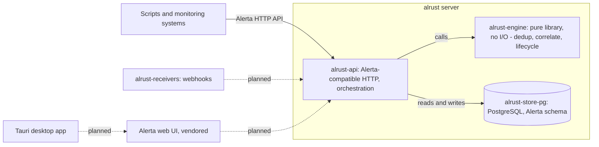

# alrust

<p align="center">
  
</p>

**An alert aggregation and deduplication server: a Rust rewrite of
[Alerta](https://github.com/alerta/alerta) on PostgreSQL. Its goal is to be
API-compatible with the Alerta API as the Alerta web UI and existing scripts
use it, and to run on Alerta's own database layout.**

> **Project stage: early alpha.** The Rust API server runs and speaks the core
> of the Alerta v9.1.0 API. It is built to be tried, not yet to replace an
> Alerta server. Full parity with Alerta is not claimed; the
> [limitations](docs/alpha.md#alpha-limitations) are listed.

[Project website](https://alrust.stel.chatgpt.site/) ·
[Quick start](#quick-start) ·
[What works](#what-works) ·
[Not yet](#not-yet) ·
[Architecture](#architecture) ·
[Roadmap](#roadmap) ·
[Contributing](#contributing) ·
[Licensing](#licensing)

---

## Quick start

You need Docker with the compose plugin on an x86_64 (amd64) host.

```sh
git clone https://github.com/steliosx/alrust.git
cd alrust
export ALRUST_ADMIN_KEY=$(openssl rand -hex 20)   # your admin API key
docker compose up --build -d
curl http://localhost:8080/management/gtg          # -> OK
```

Send an alert and read it back:

```sh
curl -s -X POST http://localhost:8080/alert \
  -H "Authorization: Key $ALRUST_ADMIN_KEY" -H 'Content-Type: application/json' \
  -d '{"resource":"web01","event":"HttpError","environment":"Production",
       "service":["Web"],"severity":"major","text":"500 on /login"}'

curl -s -H "Authorization: Key $ALRUST_ADMIN_KEY" http://localhost:8080/alerts
```

The [alpha guide](docs/alpha.md) has the rest: running without Docker, every
configuration variable, the end-to-end smoke script and the known gaps. Use a
disposable database for a trial.

## What works

| Area | State |
|---|---|
| Alerts | Receive with deduplication and correlation, the reference status and severity state machine, status changes, actions (ack, shelve, close and the others), tags, attributes, delete, history |
| Queries | `GET /alerts` and `/alerts/count` with the common filters, exclusions and paging |
| Heartbeats | Create or update, list, get, delete |
| API keys | Create, list, delete; scopes; customer assignment |
| Authentication | API keys, and verification of HS256 Bearer tokens. There is no login yet |
| Housekeeping | Expiry and deletion, on request or on an interval |
| Database | PostgreSQL 18.6 only. alrust uses the Alerta 9.1.0 schema exactly: it creates it in an empty database, or accepts an existing Alerta 9.1.0 database whose schema matches |
| Packaging | A Dockerfile and a Compose file for linux/amd64 |

The route-by-route list, with each known difference from Alerta, is in the
[alpha guide](docs/alpha.md#what-works).

## Not yet

- Blackouts, notes, customers, users, groups and permissions routes.
- Logins (basic, LDAP, OIDC, SAML). API keys are the working credential.
- Webhook receivers (Zabbix, Grafana, Prometheus and the others) and outbound
  notifications.
- Bulk routes, top-N counts, `q=` queries and regex filters.
- The web UI and the desktop app. `webui/` and `desktop/` are placeholders.
- ARM64 builds.
- **Qualification against Alerta.** The comparison suite in `conformance/`
  has not completed a full run against both servers: all 19 runtime profiles
  are `NOT_RUN`. The [status record](docs/STATUS.md) has the exact evidence.

## Architecture

`alrust-engine` is a pure library with no I/O: it computes lifecycle
decisions. The API layer does the orchestration, and reads and writes
PostgreSQL through `alrust-store-pg`.



| Crate | Role |
|---|---|
| `alrust-domain` | Types shared by the others |
| `alrust-engine` | Lifecycle decisions; no I/O |
| `alrust-store-pg` | PostgreSQL store, schema creation and adoption |
| `alrust-api` | HTTP routes and authentication |
| `alrust-server` | The `alrust` binary: configuration and start-up |
| `alrust-receivers` | Webhook receivers (empty for now) |

Compatibility is judged against pinned upstream releases, kept as read-only
submodules under `reference/`:
[alerta v9.1.0](https://github.com/alerta/alerta/tree/f4312727783dad64198b62ed778bbca98a5144a3)
and
[alerta-webui v8.7.1](https://github.com/alerta/alerta-webui/tree/2687e4afa93b41c4fa1d46201bba9ea38be0d491).
The behaviour specifications taken from that source are in `spec/`.

## Roadmap

The plan is the [project kickoff](docs/KICKOFF.md). The server was built
ahead of the Phase 0 gate by owner decision ("alpha first"), so several
phases are partly done at once.

| Phase | Scope | State |
|---|---|---|
| 0 | Specifications from the upstream source; conformance suite | Specifications written. Gate open: no full suite run against the reference in CI |
| 1 | Domain model, pure lifecycle engine, PostgreSQL store | In the alpha. Gate open: property tests and full spec vectors |
| 2 | HTTP API with the query grammar; server-sent events | Core routes in the alpha. No SSE, no `q=` grammar, no conformance result |
| 3 | API keys and OIDC for operators | API keys and Bearer verification in the alpha. No login |
| 4 | Zabbix receiver, generic webhook mapper, outbound forwarder | Not started |
| 5 | Housekeeping, heartbeat alerts, metrics, Docker, shadow-run tooling | Housekeeping and Docker in the alpha. The rest not started |
| 6 | Tauri desktop apps for Windows and macOS | Not started |

## Contributing

See [CONTRIBUTING](CONTRIBUTING.md) for how to set up a checkout, run the
checks and propose a change. In short:

```sh
cargo fmt --all --check
cargo clippy --locked --workspace --all-targets -- -D warnings
cargo test --locked --workspace
```

Behaviour must match the pinned upstream release. An intended difference in
alert lifecycle, authentication or data retention is recorded in
[DECISIONS](docs/DECISIONS.md) or an ADR under `docs/adr/`. Each change is
written by one party and reviewed at its exact commit by another before it
is merged. Releases, repository settings and security decisions belong to
the repository owner.

## Licensing

- No licence has been chosen for alrust itself yet. That is the owner's
  decision, and no licence is implied by this repository.
- Third-party Rust dependencies keep their own licences; see
  [THIRD_PARTY_NOTICES](THIRD_PARTY_NOTICES.md).
- The upstream Alerta sources that alrust is checked against keep their own
  licences, and vendored code keeps its notices:
  - Alerta server:
    [LICENSE](https://github.com/alerta/alerta/blob/f4312727783dad64198b62ed778bbca98a5144a3/LICENSE),
    [NOTICE](https://github.com/alerta/alerta/blob/f4312727783dad64198b62ed778bbca98a5144a3/NOTICE)
    (Apache-2.0);
  - Alerta web UI:
    [LICENSE](https://github.com/alerta/alerta-webui/blob/2687e4afa93b41c4fa1d46201bba9ea38be0d491/LICENSE)
    (Apache-2.0).
