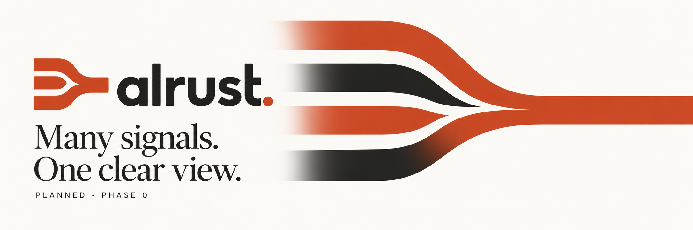
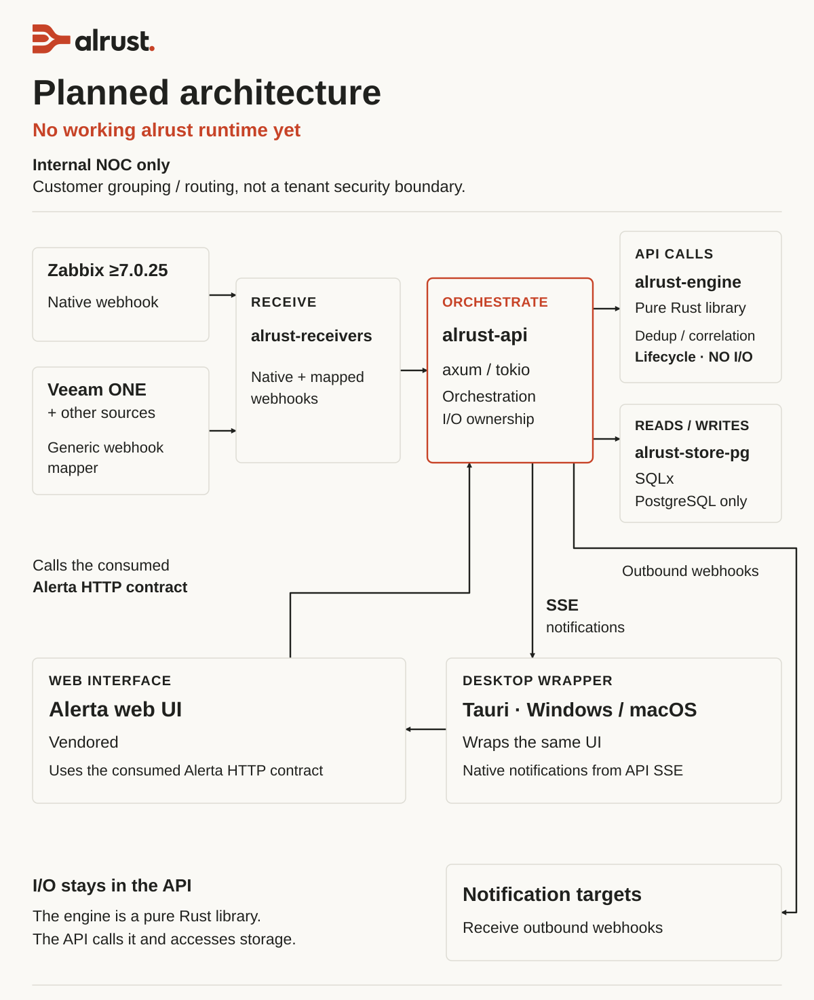
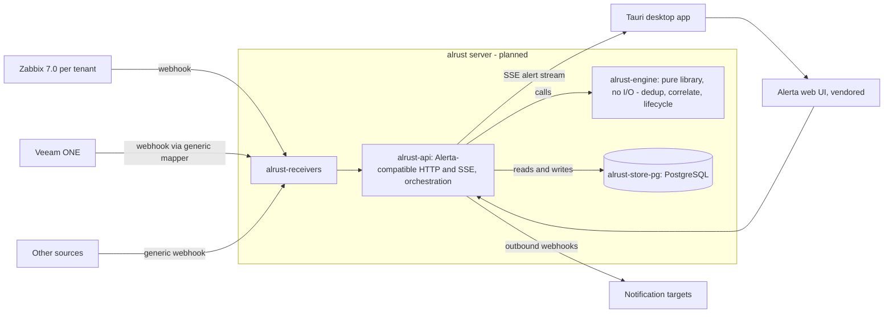
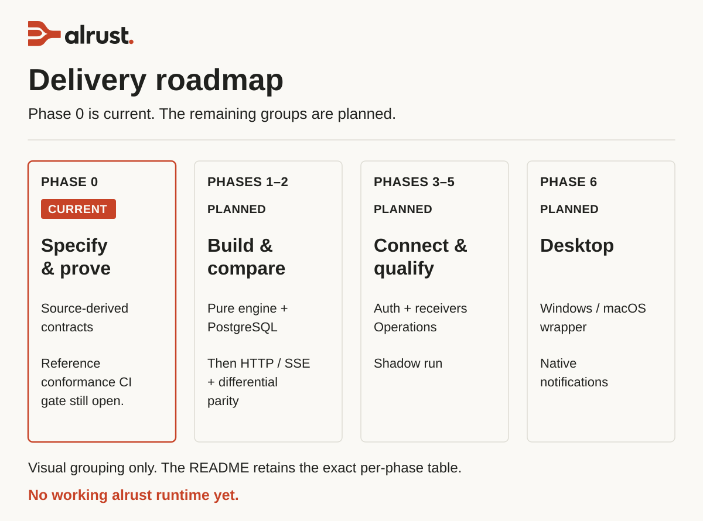

# alrust

  

**An early Rust alert aggregation and deduplication server for an MSP network
operations centre: a rewrite of [Alerta](https://github.com/alerta/alerta).
The compatibility target is the Alerta API used by the existing web UI and
our scripts.**

> **Project stage: runnable Rust API alpha on PostgreSQL 18.6.** Core alert,
> action, heartbeat and API-key routes have executing smoke-test evidence.
> Full API parity, the web UI, desktop apps and live acceptance remain open.
> The status table separates merged capabilities from unmerged work and plans.

[Project website](https://alrust.stel.chatgpt.site/) ·
[What it is](#what-it-is) ·
[Status](#status) ·
[Architecture](#architecture-planned) ·
[Getting started](#getting-started) ·
[Roadmap](#roadmap) ·
[How work is done](#how-work-is-done) ·
[Licensing](#licensing)

---

## What it is

Alrust's merged alpha receives and stores alerts, applies lifecycle decisions,
and exposes a core Alerta-shaped HTTP API. The broader goal is to collect
signals from per-tenant Zabbix instances, Veeam ONE and generic webhooks,
and present them through the Alerta web UI and desktop wrappers. Those
receivers, UI and desktop integrations remain planned.

These are the planned design decisions, fixed in the kickoff:

| Design choice | Decision (planned) |
|---|---|
| Users | Internal NOC operators only. `customer` is a grouping and routing attribute. |
| Backend | Rust (axum, tokio, sqlx) on PostgreSQL only |
| Compatibility target | The Alerta API as the Alerta web UI and our scripts actually use it; full documented API parity is not a goal. To be verified against a pinned upstream release; not yet verified |
| Frontend | The upstream Alerta web UI, vendored and lightly patched. There is no frontend rewrite. |
| Desktop | Tauri wrapper with native notifications from a new server-sent-events endpoint |
| Inbound | Native Zabbix ≥ 7.0.25 webhook receiver, and a configurable generic webhook mapper (used for Veeam ONE) |

The full plan and its fixed decisions are in the
[project kickoff](https://github.com/steliosx/alrust/blob/e839ceaf8cb43d6ed996c8fe12f884d0bb141743/docs/KICKOFF.md)
(pinned to the reviewed scaffold revision).

## Status

**Reviewed checkpoint: 3 November 2026**, main
[`a5c66fee`](https://github.com/steliosx/alrust/commit/a5c66fee0dab19563b3b8aa14ee20cbe29da1b04).
The Rust API alpha and reference-layout storage implementation remain merged.
Thirty-eight newer commits add acknowledgement-hook infrastructure, pure Zabalack
policy functions and an OIDC caller-facts design. No downstream adapter is
registered, full two-server compatibility remains open, and there is no release
or live acceptance.

| Area | Current executed evidence | Remaining limit |
|---|---|---|
| Exact-head CI | [PR #189 run 41657256490](https://github.com/steliosx/alrust/actions/runs/41657256490) succeeded at head `b8cc0d47`: seven jobs; **95 Rust tests passed, two ignored**, **3311 Python conformance-unit tests passed**, and the alpha smoke recorded zero failures or not-runs. | The hosted-profile job intentionally reports all profiles `NOT_RUN`. The reference comparison is a smoke check, not full two-server conformance, and no workflow run was found for the resulting main merge commit. |
| ACK integration hooks | [#177](https://github.com/steliosx/alrust/pull/177)–[#188](https://github.com/steliosx/alrust/pull/188) merge hook phases, reserved-key stripping and pure Zabalack receive/actor/precheck policy with tests. Source inspection at `a5c66fee` finds `Store::new` starts with an empty hook list. | No `AckIntegration` implementation is registered for Zabalack or Voalack, so this is infrastructure and policy logic, not an active adapter or installed qualification. |
| Identity and downstream pin | [#189](https://github.com/steliosx/alrust/pull/189) merges an OIDC caller-facts **design**. [STATUS](docs/STATUS.md) holds the Voalack slices because their pinned input changed. | Current runtime auth remains API-key based and caller facts carry no human user, so actor-gated ACK work is skipped. OIDC owner choices and a newly reviewed Voalack pin remain prerequisites. |
| Review evidence | Repository records attribute correction/review hashes to Codex through the signed-mailbox workflow. | GitHub shows no submitted review object for these PRs, and the automatic review on #189 stopped at a usage limit. This presentation review did not inspect the original signed mailbox artifacts. |
| Hosted CI | [Run 41549919000](https://github.com/steliosx/alrust/actions/runs/41549919000) executes **six successful jobs**; draft-only catalog generation is skipped. Python conformance units: **3311 passed, 97 subtests**. Rust tests: **46 passed, two ignored**. PostgreSQL 18.6 Rust alpha smoke and supervised Python reference smoke succeed. | Hosted execution has resumed; the earlier billing refusal is historical. Owner records retain the $0 spending limit. A reference-only smoke is not two-server conformance, and ignored/skipped checks receive no credit. |
| Execution profiles | The green catalog preflight expects **all 19 profiles NOT_RUN**. | No profile, Phase 0 or shared-CI gate is closed by that green job. The corrected selected two-target pairing remains unrerun. |
| Source fixes | [#169](https://github.com/steliosx/alrust/pull/169)–[#172](https://github.com/steliosx/alrust/pull/172) add six bounded lane shards, exact node-ID coverage checking and per-shard filesystem modes. [#173](https://github.com/steliosx/alrust/pull/173), `491e1e48`, lists the evidence staging directory through a fresh descriptor with the same device/inode check. | Source inspection supports the scoped corrections. tmpfs fsync tests do not establish disk durability. The btrfs regression models the stale descriptor; local native filesystem results are author reports. |
| Forgehold conformance lane | At `ac1543b9`, App checks report three successful shards and one failed ref-supervisor shard; two shards did not run. [#174 / STATUS](https://github.com/steliosx/alrust/pull/174) records the pause and pending signed attestations. | **0 of 6 lane-qualified passes**; the three green App results are not independently qualified custody/cleanup evidence. `pidfd_open_failed` is a reported observation; its underlying error/cause is unverified. No capability or safety-test change is approved. |
| Retained failure | [Earlier main run 41546466073](https://github.com/steliosx/alrust/actions/runs/41546466073), `ba5ce669`, failed `test_stdin_feed_obeys_call_deadline`: 3310 passed, one failed. | The later success is a separate run; no source cause/fix is established by a documentation-only successor. Held [#159](https://github.com/steliosx/alrust/pull/159) and [#157](https://github.com/steliosx/alrust/pull/157) retain their dispositions. |
| Reviews and integration | Claude's STATUS records Codex clearance for the source merges; collaboration still separates implementation and independent review through signed mailboxes. The integration-hook specification is merged. | Original signed packets were not inspected here. Automatic PR reviews hit a usage limit, not a clean completed result. Hook implementation, human-login prerequisites, Zabalack/Voalack adapters and installed qualification are separate work. |

The reference layout and runnable Rust implementation are more than scaffold
checks. Their scoped tests still do not establish complete Alerta parity,
Compose startup, web UI/desktop delivery, OIDC deployment or live integration.
This presentation review obtained no current separate Codex Security report.

Historical checkpoints — 29 September to 31 October 2026

**Reviewed checkpoint: 31 October 2026**, main
[`33b5ce02`](https://github.com/steliosx/alrust/commit/33b5ce0211af990421563bc931cd56e6ad3abc85).
The owner resumed the project (Y37), and the reference-storage implementation
is now merged. Phase 0, full compatibility and live integration qualification
remain open. Decisions Y38–Y41 settle value conversion, NULL-read refusals,
index-proposal scope and a transactional SQL-hook integration direction.
The hook and downstream adapters are not implemented or qualified by these decisions.

| Area | Current evidence | Remaining limit |
|---|---|---|
| Rust API alpha | [PR #138](https://github.com/steliosx/alrust/pull/138), head `17eacd61`, and follow-up fixes are merged. Alert receive/query/status/action/delete, heartbeat and API-key routes execute against native PostgreSQL 18.6. | Early alpha; no release, live acceptance or complete Alerta parity is claimed. |
| Earlier alpha smoke and ordinary CI | [Exact-main run 40754792921](https://github.com/steliosx/alrust/actions/runs/40754792921) passed six executed jobs at `812eb125`, including the PostgreSQL 18.6 alpha smoke and 22 store tests (two generators ignored). The draft-only catalog-generation job was skipped. | Python reference bootstrap is not two-server conformance. All 19 full executing profiles remain `NOT_RUN`; skips receive no execution credit. |
| Rust lint policy and agent guidance | [PR #152](https://github.com/steliosx/alrust/pull/152) introduced the lint policy. [PR #155](https://github.com/steliosx/alrust/pull/155) adds the three BeautifulRust skills with an Alrust scope adapter; Y37 supersedes the earlier pause. | CI's exact `-D warnings` command and project contracts remain controlling. Skills do not grant runtime or publication authority. |
| Selected two-target conformance | [STATUS](docs/STATUS.md) records the narrow local A3B run at `ff7bc55a`: Python reference 10/10, Rust candidate 9/10. The failed `event!=` case was corrected by #147. | The corrected two-target pairing has not been rerun. All 19 full executing profiles remain `NOT_RUN`; full compatibility is unproved. |
| Reference-storage compatibility | [PR #150](https://github.com/steliosx/alrust/pull/150), approved head `03d43f15`, merged as `0cf4ad8c`. [Run 40733434721](https://github.com/steliosx/alrust/actions/runs/40733434721) passed all seven jobs and 22 storage tests, including owned-sequence refusal/preservation and consistent non-string value conversion. Published STATUS records Codex approval `f274d1fa`. | Source and tests support the scoped migration correction; the private signed record was not inspected. This does not qualify Zabalack/Voalack integration or full API parity. Extra-index DDL remains a proposal; the strict catalog rule is still implemented. |
| Earlier API review findings | The [heartbeat-healthcheck](https://github.com/steliosx/alrust/pull/138#discussion_r4253845380) and [API-key scope](https://github.com/steliosx/alrust/pull/138#discussion_r4253845404) comments remain historical review records. Reference-layout adoption changes the affected storage paths. | Their affected disposition needs re-triage against this main; ordinary smoke success alone is not closure. |
| Compose and UI delivery | [Alpha guide](docs/alpha.md) contains Compose and native startup instructions; native startup is exercised in the alpha CI lane. | Compose startup itself remains `NOT_RUN` in the current records. Web UI, desktop apps, auth logins and monitoring receivers remain unimplemented. |
| Specification and execution profiles | Merged specifications, supervisors, finalizers and conformance tooling remain available; see [STATUS](docs/STATUS.md) for their exact historical bindings. | Earlier source/offline or reference-only passes are not retrospectively promoted to Rust conformance. Open specification and oracle review findings remain distinct from alpha runtime evidence. |
| Security and acceptance | Main retains its earlier executed CI; new follow-up checks are not executing. | This presentation review did not obtain a current separate whole-repository/Codex Security report and does not claim one clean. Independent acceptance and owner release decisions remain open. |

Unmerged follow-ups: [#157](https://github.com/steliosx/alrust/pull/157) at
`61ec7fc4` binds draft catalog output to the exact merge composition; its run
failed a stdin deadline control. Codex-authored [#159](https://github.com/steliosx/alrust/pull/159)
at `7ffd1c5e` adjusts that test without changing production deadlines.
Claude's published review is separate from hosted qualification: run
40756258263 failed all seven checks without executed job steps.
The unmerged Y42 record in [#160](https://github.com/steliosx/alrust/pull/160)
now reports billing/spending-limit refusal. That is a recorded admission blocker,
not a code-test failure or a pass; its original annotations were not independently
retrieved in this presentation review.
Neither PR is merged; #158 was closed unmerged and its green run does not
qualify #159's exact commit.

New unmerged work, inspected on **29 October**:

- [#160](https://github.com/steliosx/alrust/pull/160) at `67c30b57` records
  Y42/Y43 owner relays: a Forgehold disposable-microVM lane, one job/profile
  at a time, and exact-input credit only for covered checks. A plain persistent
  self-hosted runner was withdrawn. These records are proposed documentation,
  not merged runtime implementation.
- [#161](https://github.com/steliosx/alrust/pull/161) at `17c21100` proposes
  a transactional ACK-hook contract. It covers ownership, authorisation,
  staging, privacy and commit-outcome handling against pinned integration
  sources. It is not an adapter implementation or coexistence qualification.
  Its Voalack coexistence discussion uses the older `e50b2885` branch;
  newer restore work needs a separate affected review. Human-login support
  remains a prerequisite, and exact signing-key custody is an owner decision.
- The no-PR [phase-1 work branch](https://github.com/steliosx/alrust/tree/feacc8342dedb084e70f620b8a46eb8bf969e0e3)
  at `feacc834` contains an exact-commit binder, stage controls and a
  pins-only reference-guard workflow. Published STATUS relays source acceptance,
  at the earlier 29 October input checkpoint reports **no admitted execution** under the thermal limit; later attempts are distinguished below.
  A source-accepted input packet is not a successful job, evidence-custody
  readback or proven VM cleanup. Its pins-only guard would not cover the hosted
  base-diff guard or every CI job.

The new hosted runs for [#160](https://github.com/steliosx/alrust/actions/runs/40908385914)
and [#161](https://github.com/steliosx/alrust/actions/runs/40966567134) each
failed seven checks without usable executed steps. No qualifying exact-head
guard is established for either PR. All 19 full executing profiles remain
`NOT_RUN`; source approval and another branch's partial lane cannot close them.

The cost policy is **no paid CI**. The proposed Forgehold path remains subject
to its own admission, access, custody and cleanup requirements.
See [DECISIONS](docs/DECISIONS.md) for current policy and merge authority.
Signed private peer records are not reproduced here; published summaries
are evidence of recorded dispositions, not an independently inspected mailbox.

### Current lane and integration checkpoint — 31 October 2026

The previously unmerged hook contract, owner-decision records and lane workflows
are now on main: #164 `88363e31`, #162 `0472045b`, #160 `5e4b075b`,
#161 `0ffbf542`, #163 `21887406` and #165 `135fd253`.
[STATUS](docs/STATUS.md) records Codex's exact-head and merge-tree checks, and
qualification from the App checks plus the designated lane reviewer's signed,
audited attestations. This presentation review inspected the published records
and App results, not the original private signed packets.

The [fixed guard check](https://github.com/steliosx/alrust/runs/124382912223)
succeeded at `0472045b`. It covers the pins-only reference policy and its
regression controls, not a Rust build, PostgreSQL test or two-server profile.
The earlier `feacc834` checkout failure remains historical evidence.

[PR #166](https://github.com/steliosx/alrust/pull/166), approved head
`f889c968`, merges the action-pin repairs and a bounded action-compatibility
workflow. Source inspection confirms that failed credential-header reads now
refuse instead of counting as absence.
[Check 124554568668](https://github.com/steliosx/alrust/runs/124554568668)
reports success for four checkout variants and Python setup. That qualifies
setup compatibility only; the Rust, database and conformance stages remain
unexecuted in this lane.

[#167](https://github.com/steliosx/alrust/pull/167), head `7684bc97`, and
[#168](https://github.com/steliosx/alrust/pull/168), head `52b6f1b7`, merge the
current records. The latter has an [exact-head guard pass](https://github.com/steliosx/alrust/runs/124587574336).
Y49's short-run time agreement is not run admission or result acceptance.

[Current-main hosted run 41220348866](https://github.com/steliosx/alrust/actions/runs/41220348866)
has six failures without executed steps and one skipped draft-only catalog job.
The reported billing refusal remains separate from code correctness.
All 19 full executing profiles remain NOT_RUN; #157/#159 remain held.
The reported lane guest has no PostgreSQL service or sudo/apt, and cold Rust
setup may exceed its six-minute budget. Broader CI needs separately reviewed
profiles and execution evidence. Merged hook design does not implement OIDC
or either integration adapter.

### Historical unmerged lane checkpoint — 30 October 2026

Main is unchanged. [#163](https://github.com/steliosx/alrust/pull/163) at
`ab2de19b` records owner answers: OIDC operator identity, hook-only customer
claims, uniform pre-lookup API-key refusal with Voalack enabled, and Rust
signing under file-based custody. Exact key placement still needs affected
review. The one-time bootstrap merge exception was withdrawn unused.

[#165](https://github.com/steliosx/alrust/pull/165) at `74f26317` records
the smoke-specific gate, audited signed-attestation route, time-slot agreement
and the owner's proceed-within-existing-gates rule. These are unmerged records;
none supplies a general runtime, merge or release approval.

For [#164](https://github.com/steliosx/alrust/pull/164), exact head `88363e31`,
[App check 124308310170](https://github.com/steliosx/alrust/runs/124308310170)
reports smoke success. Independent verification of the exact execution through
the lane reviewer's sanitized signed attestation remains pending. It is not a
Rust build, reference guard or conformance result. Earlier text above describes
the preceding input checkpoint; a later attempted dispatch did occur and ran no
job because credentials were unavailable. Its operational stop and uncertain
cleanup remain separately recorded; a new smoke does not release that hold.

The original phase-1 guard at `feacc834` failed during checkout: its guard
and regression stages were skipped. [#162](https://github.com/steliosx/alrust/pull/162)
now advances to `0472045b` with a newer pinned checkout action.
[#166](https://github.com/steliosx/alrust/pull/166) at `6778b2b1` similarly
updates hosted checkout/setup-python pins. These are inspected source changes,
not successful replacement executions. Hosted checks still show seven
unexecuted failures under the reported billing refusal.
All 19 full executing profiles remain NOT_RUN; #157/#159 and other PRs still
need results covering their own exact source and applicable checks.

Historical checkpoint — 29 September 2026

**Historical snapshot: 2026-09-29.** This table preserves the original
checkpoint. The scaffold, specifications and conformance tooling have since
landed on `main`; consult [the current status record](docs/STATUS.md) for
subsequent merges, scoped results and the Phase 0 gate. The illustrations
describe the planned system and do not establish implementation or test results.

In the snapshot below, "unpublished" means the work existed and had been
independently reviewed, but had not yet been pushed to this repository.

| Area | State | Evidence |
|---|---|---|
| Repository scaffold (Rust workspace, CI, pinned upstream references) | Open draft [PR #1](https://github.com/steliosx/alrust/pull/1) at [`e839ceaf`](https://github.com/steliosx/alrust/commit/e839ceaf8cb43d6ed996c8fe12f884d0bb141743) | The five Rust crates are **empty libraries with zero tests**. That is scaffold only, not a working server. |
| Guard keeping `reference/` read-only | Implemented at `e839ceaf`; independently reviewed | Local checks pass. **Not enforced by GitHub**: the repository has no branch protection. |
| Hosted CI | **Blocked by account billing** | [Run 36632329142](https://github.com/steliosx/alrust/actions/runs/36632329142): jobs were never started, so no step executed. This is not a code test result. |
| Phase 0 specifications (alert lifecycle, customer mapping) | Unpublished; independently reviewed | Derived from the pinned upstream source. They are not yet checked against a running server. |
| Conformance harness (black-box Python test suite) | Unpublished; independently reviewed | 40 offline self-tests pass locally. |
| Reference smoke test (2 HTTP cases against the upstream Python server) | Passed locally | This checks the upstream **reference** server only. It is not alrust behaviour. |
| Customer, lifecycle and two-server conformance runs | Not run | — |
| alrust HTTP API, receivers, auth, desktop app | Not started | Planned phases 1–6 below |

## Architecture (planned)

The illustration shows the broader target architecture. The Rust API,
domain/engine libraries and PostgreSQL store now have alpha implementation
and executing evidence; the dedicated receivers, web UI, SSE delivery and
desktop integrations shown here remain planned. The engine computes
lifecycle decisions; API orchestration performs database I/O through
`alrust-store-pg`.

  

Editable Mermaid architecture

Compatibility is judged against pinned upstream releases:
[alerta v9.1.0](https://github.com/alerta/alerta/tree/f4312727783dad64198b62ed778bbca98a5144a3)
and
[alerta-webui v8.7.1](https://github.com/alerta/alerta-webui/tree/2687e4afa93b41c4fa1d46201bba9ea38be0d491).

## Getting started

Start with the [alpha guide](docs/alpha.md) for configuration and native
PostgreSQL 18.6 startup. The Rust server is exercised by the alpha CI lane;
the guide's Compose path has not yet been executed in the recorded
qualification environment. Use a disposable development database while
the alpha's compatibility and security findings are open.

The current [CI smoke script](scripts/alpha-smoke.py) and
[STATUS](docs/STATUS.md) describe the executed checks. This README update
does not claim an additional local startup or test run.

## Roadmap

The original phase roadmap remains the target. Reviewed alpha work proceeds
alongside Phase 0 under Y32 and the owner's 28 October resumption (Y37).
Implemented subsets do not close a later phase's gate.
The original details are in the
[kickoff](https://github.com/steliosx/alrust/blob/e839ceaf8cb43d6ed996c8fe12f884d0bb141743/docs/KICKOFF.md).

  

| Phase | Scope | Gate |
|---|---|---|
| 0 | Specs extracted from upstream source; conformance suite and differential fuzzer | Suite green against the upstream server **in CI**: GitHub-hosted, or the self-hosted x64 runner once the free hosted allowance is used up (owner decision X5); lifecycle spec reviewed. Open: local runs do not substitute for a CI run |
| 1 | Domain model, pure lifecycle engine, PostgreSQL store | Property tests and spec-derived vectors pass |
| 2 | HTTP API including the query grammar, plus a new SSE endpoint | Conformance suite green against alrust; the differential fuzzer shows no unexplained divergence over a long run; the vendored web UI works against alrust with no code changes beyond configuration |
| 3 | API keys (one per tenant source) and OIDC for operators | Auth conformance; web UI login |
| 4 | Zabbix receiver, generic webhook mapper, outbound forwarder | Replay of real captured payloads *(needs operator-supplied samples)* |
| 5 | Housekeeping, per-tenant heartbeat alerts, metrics, config, Docker, shadow-run tooling | One-week shadow run with explained diffs ≈ 0 *(needs production config)* |
| 6 | Tauri desktop apps for Windows and macOS | Both build in CI and receive live notifications *(signed builds need certificates)* |

## How work is done

- Two agents collaborate. One authors each change, and the other reviews that
  exact commit independently. Every new commit needs a fresh review.
- Changes go on isolated branches and are delivered as pull requests or
  signed bundles, one concern each.
- Reviews are recorded as signed dispositions and PR comments. Both agents
  share one GitHub login, so they are **not** formal GitHub approvals.
- Under the current Y32 minimal process, Codex reviews Claude's exact diff
  before Claude publishes and merges it; Claude independently reviews
  Codex-authored changes. The established signed mailbox workflow remains
  in place. **Only the repository owner** decides releases, authentication
  contract changes, repository settings, secrets, runners, production and
  cutover. Consult [DECISIONS](docs/DECISIONS.md) for the current authority.
- Behaviour must match the pinned upstream release. Any intentional
  difference in alert lifecycle, authentication or data retention is
  recorded in an ADR and decided by the owner.

## Licensing

- No licence has been chosen for alrust itself yet. That is the owner's
  decision, and no licence is implied by this repository.
- The upstream Alerta sources that alrust is checked against keep their own
  licences, and vendored code keeps its notices:
  - Alerta server:
    [LICENSE](https://github.com/alerta/alerta/blob/f4312727783dad64198b62ed778bbca98a5144a3/LICENSE),
    [NOTICE](https://github.com/alerta/alerta/blob/f4312727783dad64198b62ed778bbca98a5144a3/NOTICE)
    (Apache-2.0);
  - Alerta web UI:
    [LICENSE](https://github.com/alerta/alerta-webui/blob/2687e4afa93b41c4fa1d46201bba9ea38be0d491/LICENSE)
    (Apache-2.0).
