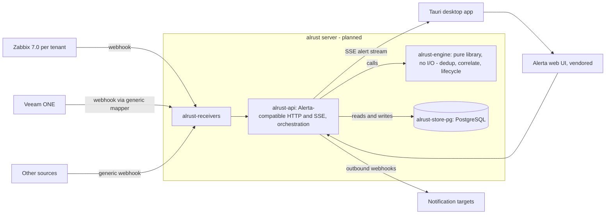

# alrust

**A planned alert aggregation and deduplication server for an MSP network
operations centre: a Rust rewrite of [Alerta](https://github.com/alerta/alerta).
Its goal is to be API-compatible with the Alerta API as the existing Alerta
web UI and our scripts use it.**

> **Project stage: planning and Phase 0 (specification and conformance
> harness).** There is no working alrust server, API or desktop app yet. The
> status table below separates what exists from what is planned.

[What it is](#what-it-is) ·
[Status](#status) ·
[Architecture](#architecture-planned) ·
[Getting started](#getting-started) ·
[Roadmap](#roadmap) ·
[How work is done](#how-work-is-done) ·
[Licensing](#licensing)

---

## What it is

The goal: alrust **will** receive alerts from many monitoring systems, such
as per-tenant Zabbix instances, Veeam ONE and generic webhooks. It will
deduplicate and correlate them, and present them to NOC operators through
the existing Alerta web UI, wrapped as Windows and macOS desktop apps. None
of this runs yet.

These are the planned design decisions, fixed in the kickoff:

| Design choice | Decision (planned) |
|---|---|
| Users | Internal NOC operators only. `customer` is a grouping and routing attribute. |
| Backend | Rust (axum, tokio, sqlx) on PostgreSQL only |
| Compatibility target | The Alerta API as the Alerta web UI and our scripts actually use it; full documented API parity is not a goal. To be verified against a pinned upstream release; not yet verified |
| Frontend | The upstream Alerta web UI, vendored and lightly patched. There is no frontend rewrite. |
| Desktop | Tauri wrapper with native notifications from a new server-sent-events endpoint |
| Inbound | Native Zabbix ≥ 7.0.25 webhook receiver, and a configurable generic webhook mapper (used for Veeam ONE) |

The full plan and its fixed decisions are in the
[project kickoff](https://github.com/steliosx/alrust/blob/e839ceaf8cb43d6ed996c8fe12f884d0bb141743/docs/KICKOFF.md)
(on the open scaffold PR; not yet on `main`).

## Status

As of 2026-09-29. "Unpublished" means the work exists and has been
independently reviewed, but is not yet pushed to this repository.

| Area | State | Evidence |
|---|---|---|
| Repository scaffold (Rust workspace, CI, pinned upstream references) | Open draft [PR #1](https://github.com/steliosx/alrust/pull/1) at [`e839ceaf`](https://github.com/steliosx/alrust/commit/e839ceaf8cb43d6ed996c8fe12f884d0bb141743) | The five Rust crates are **empty libraries with zero tests**. That is scaffold only, not a working server. |
| Guard keeping `reference/` read-only | Implemented at `e839ceaf`; independently reviewed | Local checks pass. **Not enforced by GitHub**: the repository has no branch protection. |
| Hosted CI | **Blocked by account billing** | [Run 36632329142](https://github.com/steliosx/alrust/actions/runs/36632329142): jobs were never started, so no step executed. This is not a code test result. |
| Phase 0 specifications (alert lifecycle, customer mapping) | Unpublished; independently reviewed | Derived from the pinned upstream source. They are not yet checked against a running server. |
| Conformance harness (black-box Python test suite) | Unpublished; independently reviewed | 40 offline self-tests pass locally. |
| Reference smoke test (2 HTTP cases against the upstream Python server) | Passed locally | This checks the upstream **reference** server only. It is not alrust behaviour. |
| Customer, lifecycle and two-server conformance runs | Not run | — |
| alrust HTTP API, receivers, auth, desktop app | Not started | Planned phases 1–6 below |

## Architecture (planned)

Nothing in this diagram runs yet. By design, `alrust-engine` is a pure
library with no I/O: it computes lifecycle decisions, and the surrounding
server code (orchestration) does the database reads and writes through
`alrust-store-pg`.



Compatibility is judged against pinned upstream releases:
[alerta v9.1.0](https://github.com/alerta/alerta/tree/f4312727783dad64198b62ed778bbca98a5144a3)
and
[alerta-webui v8.7.1](https://github.com/alerta/alerta-webui/tree/2687e4afa93b41c4fa1d46201bba9ea38be0d491).

## Getting started

**What `main` offers today is documentation only.** It contains this README
and nothing to build or run.

```sh
git clone https://github.com/steliosx/alrust.git   # private repository: needs access
cd alrust
```

**Optional: inspect the scaffold** from open draft PR #1, pinned to its
reviewed commit:

```sh
git fetch origin pull/1/head
git switch --detach e839ceaf8cb43d6ed996c8fe12f884d0bb141743
cargo fmt --all --check
cargo clippy --workspace --all-targets -- -D warnings
cargo test --workspace               # 0 tests: the crates are empty
```

What has been checked:
- **The git steps** were verified in a fresh clone to land on `e839ceaf`.
- **The three `cargo` commands** passed with Rust 1.98.1 at the scaffold's
  earlier commit `a674546`. `Cargo.toml`, `Cargo.lock`,
  `rust-toolchain.toml`, `rustfmt.toml` and `crates/` are unchanged at
  `e839ceaf`, so that result carries over. They were not re-run for this
  README. They show only that the empty, zero-test scaffold compiles, not
  anything about compatibility.

The upstream reference sources are git submodules
(`git submodule update --init`). The cargo checks don't need them, and that
step was not run as part of validating this README.

## Roadmap

Each phase is **planned** and has a gate that must pass before dependent work
starts. The details are in the
[kickoff](https://github.com/steliosx/alrust/blob/e839ceaf8cb43d6ed996c8fe12f884d0bb141743/docs/KICKOFF.md).

| Phase | Scope | Gate |
|---|---|---|
| 0 | Specs extracted from upstream source; conformance suite and differential fuzzer | Suite green against the upstream server **in CI**; lifecycle spec reviewed. Open: local runs do not substitute for the hosted gate |
| 1 | Domain model, pure lifecycle engine, PostgreSQL store | Property tests and spec-derived vectors pass |
| 2 | HTTP API including the query grammar, plus a new SSE endpoint | Conformance suite green against alrust; the differential fuzzer shows no unexplained divergence over a long run; the vendored web UI works against alrust with no code changes beyond configuration |
| 3 | API keys (one per tenant source) and OIDC for operators | Auth conformance; web UI login |
| 4 | Zabbix receiver, generic webhook mapper, outbound forwarder | Replay of real captured payloads *(needs operator-supplied samples)* |
| 5 | Housekeeping, per-tenant heartbeat alerts, metrics, config, Docker, shadow-run tooling | One-week shadow run with explained diffs ≈ 0 *(needs production config)* |
| 6 | Tauri desktop apps for Windows and macOS | Both build in CI and receive live notifications *(signed builds need certificates)* |

## How work is done

- Two agents collaborate. One authors each change, and the other reviews that
  exact commit independently. Every new commit needs a fresh review.
- Changes go on isolated branches and are delivered as pull requests or
  signed bundles, one concern each.
- Reviews are recorded as signed dispositions and PR comments. Both agents
  share one GitHub login, so they are **not** formal GitHub approvals.
- **Only the repository owner merges to `main`**, cuts releases, and decides
  on billing, repository settings and branch protection.
- Behaviour must match the pinned upstream release. Any intentional
  difference in alert lifecycle, authentication or data retention is
  recorded in an ADR and decided by the owner.

## Licensing

- No licence has been chosen for alrust itself yet. That is the owner's
  decision, and no licence is implied by this repository.
- The upstream Alerta sources that alrust is checked against keep their own
  licences, and vendored code keeps its notices:
  - Alerta server:
    [LICENSE](https://github.com/alerta/alerta/blob/f4312727783dad64198b62ed778bbca98a5144a3/LICENSE),
    [NOTICE](https://github.com/alerta/alerta/blob/f4312727783dad64198b62ed778bbca98a5144a3/NOTICE)
    (Apache-2.0);
  - Alerta web UI:
    [LICENSE](https://github.com/alerta/alerta-webui/blob/2687e4afa93b41c4fa1d46201bba9ea38be0d491/LICENSE)
    (Apache-2.0).
