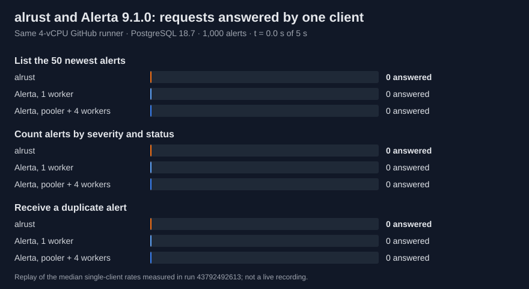

# alrust and Alerta: a diagnostic benchmark (15 November 2026)

Status: two completed runs of one harness on GitHub-hosted runners. They
measure where the per-request time goes; they are not a capacity claim.
They complement the independent comparison in #255, which measured the gap
but could not name its causes.

The animation replays the median single-client rates of run `43792492613`; it is not a live recording. `scripts/bench/make_race_gif.py` regenerates it from `2026-11-15-bench-compare-results.json`.

## Subjects and environment

| | |
|---|---|
| alrust | `main` at `b3df6928` (the harness adds no Rust code), built in CI with `cargo build --release --locked`. Its serving pool has 16 connections |
| Alerta | 9.1.0 at `f4312727` (the `reference/alerta` submodule), installed from the repository's hash locks, served by gunicorn 27.0.1 with the gthread worker |
| Database | PostgreSQL 18.7 (`18.7-1.pgdg24.04+2`), one throwaway cluster on 127.0.0.1, `max_connections=200`, otherwise defaults |
| Pooler | PgBouncer 1.26.1, transaction pooling, 16 server connections |
| Load | oha 1.17.0, HTTP/1.1 keep-alive, the same three headers on every request: `Authorization: Key …`, `Accept: application/json`, `Accept-Encoding: identity` |
| Runner | `ubuntu-24.04` hosted, 4 vCPUs, image 20261111.370.1 |
| Data | 1,000 synthetic alerts seeded once through Alerta's API, then copied with `CREATE DATABASE … TEMPLATE` for each server and each write run |

The harness is `scripts/bench/` and `.github/workflows/bench-compare.yml`
(#258). The numbers below come from run `43792492613` (all 72 measurements
valid); `2026-11-15-bench-compare-results.json` is its `results.json`, and
run `43788943429` is the earlier full run used for the comparison of runs.

## Method

Four arms separate the two causes read from Alerta's code:

| Arm | What it removes |
|---|---|
| `alrust` | — |
| `alerta-1x4` | nothing: one gunicorn worker with four threads, as #255 ran it |
| `alerta-1x4-pgb` | the database side of Alerta's per-request connection (backend fork and authentication). A lower bound: Alerta still connects to PgBouncer on every request |
| `alerta-4x4-pgb` | also the one-process limit: four workers, one per vCPU (`--preload`, see Observations) |

Three cases: `GET /alerts?page-size=50&sort-by=lastReceiveTime` (the 50
newest), `GET /alerts/count`, and `POST /alert` with one fixed body. Every
write after the first is a duplicate that updates one row on both servers,
so the write case measures the duplicate path only. Each case runs at one
and eight concurrent clients, with a 5-second warm-up and a 15-second timed
run, three repetitions, with the order of the arms rotated per repetition.

Fairness, checked in the code before the first run:
- Both servers authenticate the same key (`AUTH_REQUIRED=True` on both) and
  write its use counter on every request.
- Alerta enables Flask-Compress; alrust does not compress. Every request
  asks for `identity`, and no response was compressed.
- Neither server logs each request.
- In both cited runs, before anything was scored, every arm had to return
  the same total, the same 50 newest ids in order, and the same count. A
  repetition was scored only with no error, real responses, and the server
  alive at its end.
- Added after both runs, from Codex's review (BENCH-R1, BENCH-R2), and not
  applied to their numbers: every listed alert is checked field by field
  against its database row; the count's severity and status groups against
  SQL; and every arm's list and count bodies against the first arm's, with
  only `href` origins normalized. For the duplicate write, the alert is
  created by one request and checked in the database, and its
  `duplicate_count` must grow by exactly the 2xx responses counted, in the
  warm-up and in the timed run (oha waits for requests in flight at the
  deadline). A failed gate leaves the repetition unscored.
- Codex compared the saved check bodies of run `43792492613` afterwards:
  the list bodies match apart from `href` origins, and the count bodies
  match exactly. That does not cover every timed response, and nothing in
  the cited runs checked that the duplicate writes were saved. So the
  duplicate-write rows below are diagnostic only.

Recorded per measurement, besides latency: PostgreSQL sessions and commits
per request (`pg_stat_database`), and the CPU time per request of the
server's process tree and of PostgreSQL (including the reaped per-request
backends).

## Results (run 43792492613, medians of three repetitions)

| Case | Clients | Arm | Requests/s | p50 ms | p99 ms | Sessions per request | Server CPU ms per request | PostgreSQL CPU ms per request |
|---|---:|---|---:|---:|---:|---:|---:|---:|
| list | 1 | alrust | 361.9 | 2.72 | 3.08 | 0.000 | 1.19 | 1.51 |
| list | 1 | alerta-1x4 | 64.8 | 15.34 | 16.76 | 1.000 | 8.98 | 8.09 |
| list | 1 | alerta-1x4-pgb | 80.2 | 12.40 | 13.34 | 0.000 | 8.97 | 2.59 |
| list | 1 | alerta-4x4-pgb | 80.7 | 12.32 | 13.40 | 0.000 | 8.94 | 2.58 |
| list | 8 | alrust | 933.7 | 8.45 | 13.72 | 0.000 | 1.58 | 2.22 |
| list | 8 | alerta-1x4 | 114.6 | 69.41 | 84.38 | 1.000 | 14.35 | 11.07 |
| list | 8 | alerta-1x4-pgb | 139.3 | 57.18 | 71.34 | 0.000 | 13.68 | 3.59 |
| list | 8 | alerta-4x4-pgb | 186.1 | 42.35 | 65.65 | 0.000 | 14.90 | 3.78 |
| count | 1 | alrust | 1223.6 | 0.80 | 0.98 | 0.000 | 0.23 | 0.46 |
| count | 1 | alerta-1x4 | 87.7 | 11.27 | 12.64 | 1.000 | 6.40 | 6.61 |
| count | 1 | alerta-1x4-pgb | 121.3 | 8.18 | 9.17 | 0.000 | 6.12 | 1.24 |
| count | 1 | alerta-4x4-pgb | 120.7 | 8.24 | 8.99 | 0.000 | 6.17 | 1.24 |
| count | 8 | alrust | 3059.0 | 2.33 | 6.69 | 0.000 | 0.25 | 0.69 |
| count | 8 | alerta-1x4 | 168.2 | 47.08 | 58.44 | 1.000 | 11.67 | 8.64 |
| count | 8 | alerta-1x4-pgb | 201.5 | 39.97 | 48.21 | 0.000 | 12.38 | 1.61 |
| count | 8 | alerta-4x4-pgb | 292.5 | 27.18 | 41.25 | 0.000 | 10.32 | 1.72 |
| write (duplicate) | 1 | alrust | 997.8 | 0.99 | 1.22 | 0.000 | 0.37 | 0.37 |
| write (duplicate) | 1 | alerta-1x4 | 66.9 | 14.70 | 16.58 | 1.000 | 7.52 | 8.63 |
| write (duplicate) | 1 | alerta-1x4-pgb | 86.8 | 11.50 | 12.53 | 0.000 | 7.49 | 2.31 |
| write (duplicate) | 1 | alerta-4x4-pgb | 88.1 | 11.30 | 12.48 | 0.000 | 7.40 | 2.22 |
| write (duplicate) | 8 | alrust | 1346.0 | 5.85 | 6.51 | 0.000 | 0.46 | 0.55 |
| write (duplicate) | 8 | alerta-1x4 | 132.1 | 60.11 | 71.95 | 1.000 | 12.42 | 11.61 |
| write (duplicate) | 8 | alerta-1x4-pgb | 169.0 | 46.75 | 59.51 | 0.000 | 12.27 | 2.93 |
| write (duplicate) | 8 | alerta-4x4-pgb | 214.6 | 36.68 | 59.56 | 0.001 | 11.87 | 3.18 |

No measurement had an error or a non-2xx response, and every row is the
median of three valid repetitions. In the earlier run `43788943429`, 71 of
72 measurements were usable: the four-worker, eight-client duplicate-write
group had two (see Observations).

## Findings

Read the ratios, not the milliseconds. The two full runs ran on different
runners, and every server's single-client latency was 37% to 77% higher on
the second: about 40% for Alerta and for alrust's list, but 67% to 77% for
alrust's sub-millisecond count and write, where fixed per-request overhead
weighs more on a slower machine. So the list's ratio held closely and the
count's and write's moved. Single-client median latency, Alerta divided by
alrust (run 43792492613, then run 43788943429):

| Case | Alerta as #255 ran it (1 worker) | Alerta with pooler and 4 workers |
|---|---|---|
| list of 50 | 5.6× and 5.5× | 4.5× and 4.3× |
| count | 14.1× and 17.3× | 10.3× and 12.5× |
| write (duplicate) | 14.8× and 17.0× | 11.4× and 13.4× |

**Measured causes:**
1. **Per-request work in the server.** Alerta's process spends 9.0 ms of
   CPU on a list request, 6.4 ms on a count and 7.5 ms on a duplicate write.
   alrust spends 1.2, 0.23 and 0.37 ms: 7.5, 28 and 20 times less (one
   client). With one client, a pooler and more workers left Alerta's
   per-request CPU about the same (8.9 to 9.0 ms on the list), so at one
   client this is most of the remaining gap.
2. **A new database connection per request.** Alerta opens and closes a
   PostgreSQL connection for every request (`database/base.py`: `get_db` and
   `teardown_db`). Sessions per request are 1.000 on the direct arm and 0
   behind PgBouncer. On the list, with one client, PostgreSQL's CPU per
   request was 8.1 ms direct and 2.6 ms behind PgBouncer, a difference of
   about 5.5 ms, and the median latency was about 3 ms lower. The difference
   includes the per-request backend start and authentication, but it does
   not measure them alone, and the other cases differ by other amounts.
   alrust keeps a pool, so it opens none.

**Read from the code, not measured separately:**
- A list request costs Alerta about seven database round trips (the
  connection's `SET search_path` and commit, the key lookup and its update,
  severity counts, status counts, the page). alrust makes three (the key
  update, one grouped count query, the page). The commits per request in
  the table (about 4 against 3, and 7 against 2 for writes) agree.
- Alerta builds a Python object per alert and serializes it to JSON in the
  interpreter; alrust does both in compiled code.

**At eight clients, the bottleneck was not isolated.** The server and
PostgreSQL together used, per second of the timed run, about 3.5 of the
four vCPUs for alrust's list, 2.85 for its count and 1.36 (1.34 to 1.38) for
its duplicate write; Alerta's arms used 2.4 to 3.5. Client, pooler and other
waits on the machine were not measured, other jobs on a shared runner may
interfere, and a limit in the server or on the one updated row (for the
duplicate write) was not ruled out. So the eight-client numbers are left out
of the comparisons, without claiming that the machine was saturated, and the
four-worker arm does not cleanly isolate the one-process limit. The
single-client latency and per-request CPU are the comparable figures.

## Observations

- **Alerta's multi-worker start can deadlock.** Every Alerta worker runs
  `sql/schema.sql` when it starts (`create_engine`), and the lock around it
  (`threading.Lock()`, created inside the call) serializes nothing between
  processes. In run `43788943429`, four workers started together, two
  deadlocked on that DDL ("deadlock detected … AccessExclusiveLock"), one
  failed to boot and gunicorn stopped. That repetition is excluded from the
  findings. The harness now starts multi-worker Alerta with `--preload`, so
  the schema runs once, in the master. The two runs' harnesses differ in
  this setting, and `--preload` avoids the race in this harness only; it is
  not a general fix for Alerta.
- **The JSON differs only in formatting.** The same 50 alerts are 41,048
  bytes from alrust and 44,130 bytes from Alerta, which puts a space after
  each `:` and `,`. Written compactly, both are 41,048 bytes; the fields
  and values are the same apart from the configured base URL in `href`.

## What this does not establish

One hosted 4-vCPU runner at a time, 1,000 synthetic alerts, three
repetitions, one PostgreSQL configuration (defaults, 18.7 for both
servers). No confidence interval beyond the spread of three medians. The
duplicate-write numbers predate the check that the writes were saved, so
they are diagnostic. The write case is the duplicate path only: no new-alert, correlation or
history-heavy write. No search (`q=` is not on `main`), no web UI traffic,
no production workload, no tuning study of either server beyond the arms
above, and nothing above 1,000 alerts. Alerta's own JSON encoder,
gunicorn's settings and PgBouncer's pool size were not varied. The results
do not qualify a release, ARM64, or any of the 19 formal profiles, which
stay `NOT_RUN`.
