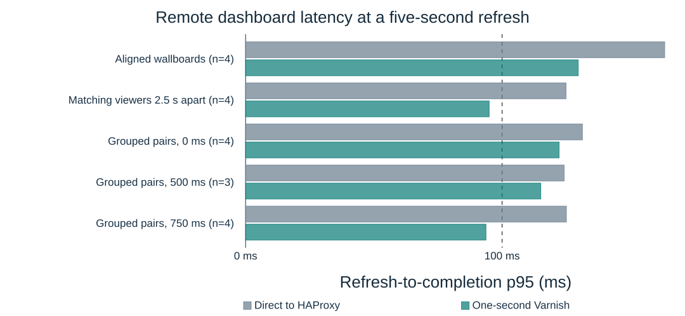

# Does a one-second Varnish cache help an Alerta dashboard across two sites?

Start with the **refresh schedule**. On the hosted two-site replay, spreading independent five-second dashboard reads reduced remote dashboard p95 from **163 ms to 125 ms with Varnish off**. For a wall that needs all eight panels to update together, keep the refresh synchronized. Adding one-second site-local Varnish to that workload reduced remote dashboard p95 from **163 ms to 130 ms**, moved the whole wall's p95 from **171 ms to 139 ms**, and avoided **320 of 800 origin requests**.

Send writes directly to HAProxy as a starting configuration. Retain the cache as an opt-in for matching, read-only dashboard requests whose users can tolerate stale data and delayed key revocation. Sites with personal credentials or unique filter URLs should measure the direct, staggered baseline first.

## Hosted two-site results

One manual Ubuntu 24.04 job attempted **34 paired trials**. **33 pairs** passed the independent replay checks, comprising **10,557 dashboard refreshes, 2,640 writes and 1,277 companion environments GETs**. The workflow finished red because one additional pair encountered a real HTTP 503. It completed every planned case, and all 34 teardown checks passed. [GitHub run](https://github.com/steliosx/alrust/actions/runs/44845401351) · [Benchmark source](https://github.com/steliosx/alrust/tree/697cbc6be618425b42f3ee55b7cc2995b4593ac5/scripts/bench/dual-site) · [Results by pair](2026-11-21-two-site-varnish-hosted.json)

The figures below are **medians of the per-run p95s**. Each arm lasted 50 seconds. The fixed schedule offered eight panels per site and four writes across both sites every five seconds. Arm order alternated by seed. For the grouped schedules, four groups start at different phases, 1.25 seconds apart, with the matching viewer of each group delayed by the stated gap. All groups use the same four scoped identities per site. “Spread” places matching readers 2.5 seconds apart.

| Fixed shared wallboard schedule | Qualified pairs | Site B read p95, direct → cache | Site A read p95, direct → cache | Site B cache hits / reads | All 8 panels at B, p95 from cycle start, direct → cache |
|---|---:|---:|---:|---:|---:|
| All panels aligned | 4/4 | 163 → 130 ms | 32 → 27 ms | 160/320 | 171 → 139 ms |
| Spread | 4/4 | 125 → 95 ms | 10 → 10 ms | 0/320 | 4.66 → 4.60 s |
| Groups, matching viewers simultaneous | 4/4 | 131 → 122 ms | 13 → 11 ms | 160/320 | 4.03 → 3.97 s |
| Groups, 500 ms between matching viewers | 3/4 | 124 → 115 ms | 10 → 10 ms | 120/240 | 4.52 → 4.41 s |
| Groups, 750 ms between matching viewers | 4/4 | 125 → 94 ms | 10 → 10 ms | 160/320 | 4.78 → 4.66 s |



**The fastest individual read and the fastest complete wall are different choices.** All 160 aligned remote hits overlapped the corresponding origin request. Their median service time across repeats was 73 ms. At the 750 ms gap, all 160 remote hits arrived after their matching origin request completed, with a median service time of 0.93 ms. The last panel was deliberately scheduled later. Across the four 750 ms trials, cached remote p95 ranged from 71 to 119 ms. The 500 ms trials also ranged from 72 to 117 ms. The data support grouping and spacing as tuning knobs without selecting a universal gap.

**Zero hits still changed latency.** Spreading the shared viewers produced zero hits while the Varnish path still showed a lower remote p95. Separate credentials also produced zero hits in 320 remote reads across the aligned and spread personal-view trials. The direct and Varnish paths differ in their HTTP connections to the origin. Packet jitter and loss were emulated, and this runner could not pin the NetEm random sequence. The measurements isolate the origin requests saved by real hits. A three-arm repeat with direct HAProxy, Varnish forced to pass every request, and eligible caching is needed to attribute the rest of the latency change.

### Writes, freshness and the real dashboard journey

- **Write path.** Across all attempted arms, direct HAProxy acknowledged 1,440/1,440 writes. The path through Varnish acknowledged 1,279/1,280. In the excluded 500 ms pair (seed 14), a site A POST returned HTTP 503 and Varnish recorded one failed fetch. The application received-timer advanced 39 times. The 39 successful write receipts accounted for every durable duplicate increment, and the primary and standby digests matched. The lower-level cause of the failed fetch was unrecorded. The harness retained the failure and did not replay the POST. After this run, the harness gained a diagnostic that collects only categorized Varnish FetchError records when a timed fetch fails. Its parser passed offline tests. A live recurrence would be needed to verify which category applies.
- **Direct-write control.** With POSTs going directly to HAProxy in both arms, the two aligned repeats gave remote write p95 of 119 → 119 ms. Remote dashboard p95 still improved from 161 to 122 ms. In the mixed newest-first trace, 640 pages across both arms matched a possible tenant-specific SQL snapshot, with no observed page behind an already acknowledged change.
- **Full-page freshness.** Across qualified hosted cache pairs, the latest first observed correct response at B came **1.193 s** after an acknowledged new alert and **1.176 s** after revoking a warmed read key. The latest observed old response was at 992 ms for content and 991 ms for access. These are observed bounds for the on-demand probes. A dashboard refreshing every five seconds can wait longer before it issues its next request.
- **List plus environments.** In the completion-paced aligned case, both responses at B finished at p95 154 → 137 ms. The uncached environments request finished last in 65 of 160 cached-arm refreshes. With matching viewers 500 ms apart, full refresh p95 was 126 → 98 ms, and that companion finished last in 69/160 cached-arm remote refreshes. The direct arm completed 157 remote refreshes versus 160 through Varnish at that gap. Compare counts as well as latency when refreshes wait for a response.

### Environment and evidence

This is a healthy topology emulated on one hosted VM. Sites A and B each had two Alerta app instances, HAProxy, PgBouncer and a cache in the cached arm. PostgreSQL A accepted writes, PostgreSQL B streamed asynchronously, and the third site hosted only an etcd voter. Site B misses crossed the emulated HTTP link to the writer-adjacent app. The lab used PostgreSQL 18.7, Patroni 4.1.5, etcd 3.6.15, PgBouncer 1.26.1, HAProxy 3.4.7, Gunicorn 27.0.1, Varnish 7.1.1 and the pinned Alerta reference. The entire topology and load generator shared a two-CPU quota, a 4 GiB memory ceiling and zero swap allowance. Physical temperature was unavailable inside this hosted guest.

Configured SQL / WAL / etcd RTTs were 50 / 100 / 30 ms. HTTP used 50 ms RTT, 4 ms jitter, 0.1% loss per direction and a 4 Mbit/s configured rate. The independent HTTP bulk probe measured 1.80–3.01 Mbit/s across qualified runs. The experiment measures synthetic API clients and one environment. It does not establish production capacity, physical site failover, TLS behavior or the cost of custom Python plugins.

The original [hosted artifact ZIP](2026-11-21-two-site-varnish-hosted.zip) is 1,323,464 bytes, SHA-256 `2cfd7d5651213c897ca4f605c6d2ad87d8110dac50b3e8d6cd3dafe2246c739e`. Its digest matched GitHub artifact `14687735318`. The offline analysis verified each run's source manifest at `697cbc6be618425b42f3ee55b7cc2995b4593ac5`, paired trace and fixture, response/accounting records, and primary/standby evidence. Run from this benchmark branch with Python 3.12 or newer:

```sh
work=$(mktemp -d)
unzip -q docs/performance/2026-11-21-two-site-varnish-hosted.zip -d "$work"
python3 scripts/bench/dual-site/analyze_cache_matrix.py "$work" "$work/analysis.json" --repo .
cmp "$work/analysis.json" docs/performance/2026-11-21-two-site-varnish-hosted.json
```

For an independent deployment, start with direct/staggered dashboards on your actual VM layout, then add a one-second read cache and the forced-pass control. Record panel p95, time to update the entire wall, ingest acknowledgements, origin reads, and the longest observed stale or authorized response after mutation. Choose from the configurations that meet your own freshness and revocation requirements. [Method, fixture and suggested prompt for your agent](two-site-cache-replay-method.md)

## Laptop measurements

In the laptop trial, eight synchronized wallboards at the remote site shared four authenticated pages. Varnish reduced remote dashboard p95 from **2.10 s to 1.47 s**. All 40 remote cache hits arrived while a matching origin request was still in progress. Those hits took 931 ms at the median. In a separate, spaced mixed trace, all eight remote hits arrived after the origin request had completed and took 6 ms at the median. For an operator choosing a refresh policy, count how many viewers arrive during a fill and how many arrive while the page is already warm. The two traces also differed in their filters and write mix.


Each row represents one cache-off and one cache-on run with the same arrivals and fixture. The latency clock runs from scheduled arrival to validated response. Each site's HAProxy routed origin reads to the app beside the writer at site A. A warm site B cache hit stayed at B. The standby at B replayed writes asynchronously. The app, PgBouncer, PostgreSQL, Patroni, three etcd members, two caches and load generator shared one laptop. The CPU quota was 25% of one CPU. The remote HTTP link was configured for 50 ms RTT, 4 ms jitter, 0.1% loss in each direction and 4 Mbit/s. There were 272 synthetic alerts across four tenants. Both arms used the same Python add-on.

| Workload | Remote reads per arm | Remote dashboard p95, off → on | Local dashboard p95, off → on | Remote ingest p95, off → on |
|---|---:|---:|---:|---:|
| Shared wallboards, five-second refresh, aligned | 80 | 2,104 → 1,470 ms | 1,204 → 1,145 ms | 770 → 208 ms |
| Mixed views, aligned | 32 | 1,346 → 1,135 ms | 1,070 → 925 ms | 1,320 → 1,066 ms |
| Mixed views, spread, newest-first with mutations | 32 | 424 → 299 ms | 305 → 235 ms | 335 → 374 ms |

The wallboard cache avoided 80 of 200 origin requests across both sites. In the newest-first trial, 128 timed pages across the two arms matched tenant-specific database snapshots consistent with observed writes. The verification also reconciles duplicates, fresh alerts, API-key and query accounting and the final standby state. The direction of the ingest result varied across traces. These measurements give no general ingest-speed estimate.

**Freshness and access revocation.** In a separate warm-page probe after the newest-first run, the remote site still returned the old page at 879 ms and first showed the new alert at 1,134 ms. After revocation, it still served the warmed key at 861 ms and first returned HTTP 401 at 1,395 ms. These are sampled client-observed completion times after the operation was acknowledged. A one-second object TTL does not guarantee one-second visibility or denial. Send authenticated traffic directly to Alerta when its hooks or revocation must take effect on every request.

Three of ten laptop trials qualified, contributing 720 timed arrivals. Seven exclusions remain in the evidence. One trial lost a connection during a probe, one had an unclassified non-JSON write response, and the others encountered thermal stops or were interrupted. The laptop reached 99 °C during one excluded trial. Local integration testing stopped. The shared-host design, one pair per workload, small write counts, synthetic authentication and healthy writer limit the conclusions. These trials did not measure physical WAN capacity or failover. [Derived results](2026-11-21-two-site-varnish-results.json) · [Compressed synthetic receipts](2026-11-21-two-site-varnish-samples.json.gz)

## What the earlier single-host test establishes

In a separate five-second GitHub-hosted quick test with four concurrent clients, repeating the same list returned about 14,893 requests/s with a one-second TTL and 15,070 requests/s with a five-second TTL. At the front end, the first observed rejection of a revoked key moved from 1.041 s to 5.033 s. With the two-second policy, unique list URLs returned 232 requests/s versus 244 direct, and duplicate writes returned 410 requests/s versus 419 direct. The cached read ceiling came from repeated reads of one object. That test offers little reason to lengthen the TTL for a similar hot list. Its single host, five-second samples and request mix differ from the two-site dashboard replay. [Earlier hosted run](https://github.com/steliosx/alrust/actions/runs/44819752743) · [Verified cells and probes](2026-11-21-two-site-varnish-results.json)

## Reproduce the comparison

Start by counting matching requests *per site and identity* within the TTL. Keep the same credentials, URLs, site routing and writes between arms. The runner can vary panel phase, issue separate credentials, include the environments request alongside the list, or drive refreshes from completion. Report the completed refresh count, both sites' p95s, origin requests, errors and the client-observed stale interval for new alerts and revoked keys. The included offline verifier checks the trial and reconstructs the published measurements. [Method and commands](two-site-cache-replay-method.md) · [Hosted matrix](../../scripts/bench/dual-site/hosted_matrix.py)
