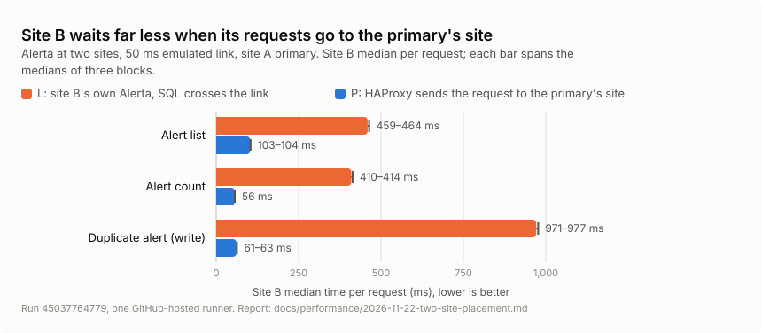
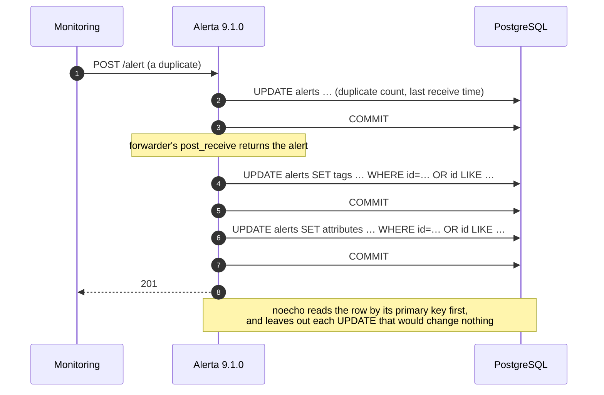

# Making Alerta faster: what we measured

This folder holds the measured reports of the project. Most of them answer one question: **how
fast can Alerta 9.1.0 as released (no fork) be made on PostgreSQL**, at one site and at two data
sites with a witness, using configuration, PostgreSQL itself and one add-on file. This page
collects what the reports found, in one place, with pictures. Each finding links to its report,
where the method, the checks and the raw results are.

**Read every number with its conditions.** The three charted reports below used GitHub-hosted
runners (4 vCPUs) with synthetic alerts, and the two-site run used emulated links between the
sites on one machine. Some reports in the index were made on other machines (a laptop); each
report names its machine.
The numbers are diagnostic and relative to those runs. They are not a capacity claim for your
installation.

- **Operator steps, in short:** [Making stock Alerta faster](alerta-operator-guide.md) says
  what to change. This page says what was found and why.
- **The add-on:** [`scripts/bench/alerta_fast.py`](../../scripts/bench/alerta_fast.py)
  replaces a few of Alerta's functions when gunicorn starts. Its default (`safe`) keeps every
  write of Alerta as it is. The other patches are opt-in. Its file header lists, for each patch,
  what changes.
- **Alrust compared with Alerta:** see [the end of this page](#alrust-compared-with-alerta).

## At a glance

| If you run… | Do this | Measured change | Where it does not help | Report |
|---|---|---|---|---|
| Two data sites, one PostgreSQL primary | Send each site's HTTP requests to the Alerta at the **primary's** site (HAProxy checks Patroni's role) | Site B, 50 ms link: list 459–464 → 103–104 ms; duplicate write 971–977 → 61–63 ms | Failover, fallback and recovery were not tested | [two-site placement](2026-11-22-two-site-placement.md) |
| Alerta's default `PLUGINS`, and you do not forward alerts | Remove `forwarder` from `PLUGINS` | +39 to +45% duplicate writes per second (8 clients, with the add-on's `safe` patches; the gain without the add-on is in a report not yet written) | Nothing, if you need forwarding | [fastpath](2026-11-21-fastpath-bench.md) |
| You need `forwarder` | `ALERTA_FAST=safe,noecho` | +21 to +31% duplicate writes per second (8 clients); 6 to 14% less WAL at two sites | Site B's duplicate write was 1.2 to 2.4 ms slower at low load; alerts whose tags change on every receive | [fastpath](2026-11-21-fastpath-bench.md), [two-site](2026-11-22-two-site-placement.md) |
| Dashboards and saved views that repeat searches | `ALERTA_FAST=safe,savedq` | Server CPU per request −73% (one recurring search), −47% (16 in turn) | +2 to 3% CPU when every search text is new | [savedq](2026-11-22-savedq-load.md) |
| Searches such as `a AND b AND c` | Group them: `(a AND b) AND c` | Alerta's stock parser keeps only the first two terms of an ungrouped chain | — (a correctness finding, not a speed-up) | [savedq](2026-11-22-savedq-load.md#a-finding-about-alertas-own-parser) |

## The lab, as measured

Each number on the map is one of the findings below.

In the two-site lab, each data site has HAProxy, PgBouncer in transaction mode and two Alerta
processes with at least the add-on's `safe` patches (among them, one kept PostgreSQL connection
per worker thread). The runs of ② and ③ used one site on one runner. ④, the lab's own limits,
is at the end.

## ① Two sites: send requests to the primary's site

**The cost.** When site B's Alerta serves site B's users, it reaches the PostgreSQL primary at
site A across the link for its SQL. When site B's HAProxy sends the HTTP request to the Alerta at
site A instead, the request crosses the link and its SQL runs at site A.

<picture>
  <source media="(prefers-color-scheme: dark)" srcset="assets/two-site-placement-dark.svg">
  
</picture>

| Site B request (median, range of three blocks) | L: site B's own Alerta | P: Alerta at the primary's site |
|---|---:|---:|
| Alert list | 459 to 464 ms | 103 to 104 ms |
| Alert count | 410 to 414 ms | 56 ms |
| Duplicate alert (write) | 971 to 977 ms | 61 to 63 ms |

In L, a site B count took about 8 times and a duplicate write about 19 times the link's 50 ms
round trip. Site A's times did not change with site B's route. The lab's HAProxy configuration
([`haproxy-affinity.cfg`](../../scripts/bench/dual-site/haproxy-affinity.cfg)) checks
Patroni's primary role and each Alerta's readiness, and falls back to the other site's Alerta.

**Not tested:** promotion, fallback, recovery, a real network, synchronous replication.
Report: [2026-11-22-two-site-placement.md](2026-11-22-two-site-placement.md).

## ② Duplicate alerts: two of three writes are an echo

**The cost.** Monitoring systems often send an alert again while it is still open, and Alerta
stores it as a duplicate. With Alerta's default `PLUGINS`, the `forwarder` plugin returns the alert from `post_receive`, even
with no destination. Alerta then writes the alert's tags and its attributes again: two more
`UPDATE` statements, each with its own commit. Each has `WHERE id=… OR id LIKE …`, which
PostgreSQL could not answer from the primary key on the test runners, so it read the whole
table.

The diagram leaves out the other statements of a request (the duplicate check, the API key's
use count, the timers).

With one new alert and 20 duplicates, Alerta made 62 row updates of `alerts` with the default
plugins, and 20 with `noecho`.

<picture>
  <source media="(prefers-color-scheme: dark)" srcset="assets/duplicate-writes-dark.svg">
  
</picture>

| Arm (every arm has the `safe` patches) | 1 client, writes/s | 8 clients, writes/s | Change at 8 clients, each repetition |
|---|---:|---:|---|
| Default plugins (baseline) | 309.3 | 737.7 | |
| `forwarder` removed | 393.7 | 1047.6 | +44.9%, +38.8%, +42.0% |
| `noecho` | 341.4 | 930.9 | +27.8%, +30.5%, +21.4% |
| `noecho` and `hot` | 415.1 | 1108.4 | +25.5%, +49.2%, +50.6% |
| Index `alerts (id text_pattern_ops)` | 319.3 | 731.0 | +0.4%, −0.0%, −3.1% |

What this says:

- **If you do not forward alerts, remove `forwarder`.** It is the largest gain from one change,
  and it needs no code.
- **`noecho` gets part of the way.** The two reads and the two commits stay, so it does not reach
  `forwarder` removed. PostgreSQL CPU per request fell from 2.155 to 1.577 ms at 8 clients. At two
  sites, `noecho` cut alert-row updates from 116 to 36 per run and the primary's WAL by 6 to
  14%, but did not make requests faster at that low load.
- **`hot`** writes the API key's use count and the timers about once a second in place of on
  every request. Use it only where those counts may be approximate.
- **The index** had little effect on 1,000 alerts, where a full scan is cheap. Its effect on a
  large table is being measured (see [In progress](#in-progress-not-results-yet)).
- **Before you turn on `noecho`,** read the add-on's file header: the stored tag order, a
  change that another request commits at the same time, alerts whose id begins with this id, and
  your own UPDATE triggers on `alerts`.

Reports: [2026-11-21-fastpath-bench.md](2026-11-21-fastpath-bench.md),
[2026-11-22-two-site-placement.md](2026-11-22-two-site-placement.md).

## ③ Searches: keep the parse, and group your terms

**The cost.** Alerta parses the `q=` search text of every request into SQL, again for each
request. The opt-in `savedq` patch keeps, in
each worker, the SQL condition and values that Alerta's parser made for its most recent search
texts (256 by default). It never keeps results: every request still reads the database with its
caller's customer scope. With one recurring complex search, the server's CPU per request fell by
about 7.5 ms. Less parsing agrees with that; the run did not time the parser on its own.

<picture>
  <source media="(prefers-color-scheme: dark)" srcset="assets/savedq-cpu-dark.svg">
  
</picture>

| Search shape | CPU per request, 40 requests/s | p95, 40 requests/s | Requests/s, 8 clients at full speed |
|---|---|---|---|
| One search, again and again | 10.29 → 2.76 ms | 28.78 → 5.51 ms | 218.4 → 696.7 |
| Sixteen searches in turn | 3.84 → 2.09 ms | 6.35 → 4.45 ms | 550.8 → 972.0 |
| A new search text every time | 11.16 → 11.41 ms | 30.86 → 31.59 ms | 196.9 → 195.1 |
| No search (control) | 3.33 → 3.24 ms | 5.56 → 5.34 ms | 574.8 → 569.1 |

**A finding about Alerta itself.** Alerta 9.1.0's PostgreSQL search parser keeps only the first
two terms of an ungrouped chain, and shows no error:

| Search text | What the stock SQL tests |
|---|---|
| `severity:(major OR critical) AND service:web AND NOT group:disk` | severity and service only |
| `(severity:(major OR critical) AND service:web) AND NOT group:disk` | all three |

Put parentheses around the first two terms. This happens with or without the add-on.
Report: [2026-11-22-savedq-load.md](2026-11-22-savedq-load.md).

## ④ What the lab does not show yet

- **etcd round trips for Patroni.** A lab finding of 23 November (recorded in
  [STATUS](../STATUS.md)): in the two-site lab, Patroni's etcd client traffic goes to local ports
  with no added delay; only etcd peer traffic uses the emulated link. The two-site results so far
  measure Patroni with a near-zero round trip to etcd. A change that sends Patroni's etcd
  traffic through the emulated links is in preparation.
- **Large tables.** Every finished run used about 1,000 alerts or fewer.
- **One machine.** Servers, PostgreSQL and the load tool share one runner. There is no real
  network.

## In progress (not results yet)

These are pull requests under review. They have no full run yet, so this page gives no numbers
for them.

- **PostgreSQL tuning, step 1: the id prefix index on a large table**
  ([#291](https://github.com/steliosx/alrust/pull/291)). On the runners, PostgreSQL's
  collation is `C.UTF-8` from the C library. With that collation, the primary key on `alerts.id`
  cannot answer `id LIKE 'prefix%'`, so the two tag and attribute `UPDATE`s of ② read the whole
  table. An index with `text_pattern_ops` can answer it. In the first test run, probes of that
  prefix predicate on 100,000 alerts showed a full scan without the index and an index scan with
  it. Those probes are not Alerta's full statements, so they give no timing for the deployed
  `UPDATE`s; the corrected suite will measure that.
- **A response cache at each site** ([#290](https://github.com/steliosx/alrust/pull/290)): an
  eligible read enters the site's Varnish first, whose backend is the site's primary-aware
  HAProxy; writes bypass Varnish.
- **Building alert pages with less CPU**, the opt-in `alertlinks` and `fastdates` patches, with
  a byte-for-byte check against Alerta's own answers
  ([#288](https://github.com/steliosx/alrust/pull/288)).

## Measured, not written up yet

Four full runs of the `bench compare` workflow have no report yet. Their results are kept in
each run's artifact, and this page gives no numbers for them until a report is reviewed.

| Run | Suite | Question |
|---|---|---|
| [44764620681](https://github.com/steliosx/alrust/actions/runs/44764620681) | `tuning` | Deployment settings only: `forwarder` removed, PgBouncer over TCP and over a Unix socket |
| [44818483781](https://github.com/steliosx/alrust/actions/runs/44818483781) | `addon` | The add-on's patches, before `noecho` and `savedq` existed |
| [44875194302](https://github.com/steliosx/alrust/actions/runs/44875194302) | `cache` | A Varnish response cache in front of Alerta at one site, with short expiry times |
| [44906946320](https://github.com/steliosx/alrust/actions/runs/44906946320) | `pg19` | PostgreSQL 19.0 against 18.7 for Alerta |

## Alrust compared with Alerta

Alrust is this project's Rust server for Alerta's API and database layout. The reports below
compare it with Alerta 9.1.0; the [project README](../../README.md#performance) has the summary.
These runs measure a different question from the rest of this page.

## All reports

**Making stock Alerta faster**

| Date | Report | Question |
|---|---|---|
| 2026-11-21 | [Fastpath suite](2026-11-21-fastpath-bench.md) | What do removing `forwarder`, `noecho`, `hot` and the id index change for duplicate writes? |
| 2026-11-22 | [Saved searches under gunicorn](2026-11-22-savedq-load.md) | What does `savedq` change for whole HTTP requests? |
| 2026-11-22 | [Alerta at two sites](2026-11-22-two-site-placement.md) | Where must a site B user's request go, and what does `noecho` change there? |
| — | [Operator guide](alerta-operator-guide.md) | What to change, from the reports above |

**Alrust compared with Alerta**

| Date | Report |
|---|---|
| 2026-11-13 | [Alerta and alrust comparison](2026-11-13-alerta-comparison.md) |
| 2026-11-15 | [A diagnostic benchmark](2026-11-15-bench-compare.md) |
| 2026-11-17 | [Mixed load, pool size and key use](2026-11-17-mixed-bench.md) |
| 2026-11-20 | [The diagnostic benchmark on a laptop](2026-11-20-bench-compare.md) |
| 2026-11-20 | [Mixed load on a laptop](2026-11-20-mixed-bench.md) |

**Method and PostgreSQL**

- [Benchmark methodology: mixed load and the connection pool](benchmark-methodology.md)
- [PostgreSQL evaluation](postgresql-evaluation-2026-11-14.md) and
  [PostgreSQL 18.7: pins and checklist](postgresql-18.7-candidate.md)

## Run it yourself

The harnesses are in [`scripts/bench/`](../../scripts/bench/) and run as GitHub Actions
workflows: `bench compare` (suites such as `fastpath`), `bench two-site` and
`addon savedq load`. Each report names its run, its commit and its artifact. The charts on this
page are drawn by [`scripts/gen-perf-figures.py`](../../scripts/gen-perf-figures.py) from
numbers quoted in the reports; `python3 scripts/gen-perf-figures.py --check` confirms that each
bar's value is in its report and that the SVG files are current.
